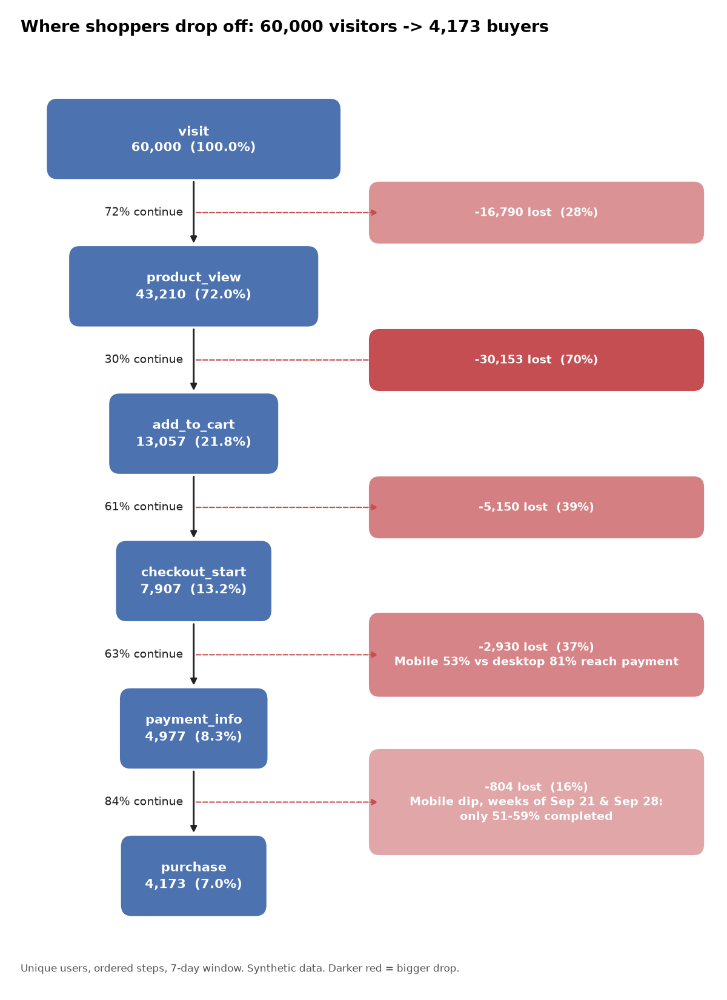

# E-commerce Funnel Analysis (SQL + Python)

Where do shoppers drop off between first visit and purchase, who drops off, and what is it costing?
This project answers that with an ordered, windowed funnel built in **SQL (SQLite)** and visualised with **Python**.

> **Data note:** the dataset is synthetic (60,000 users, ~137k events, Aug 3 to Oct 25 2026), generated by `src/generate_data.py`
> with realistic quirks (duplicate events, return visitors, a mid-period bug). The method carries over to real clickstream data; see "Next steps".

## Funnel definition
`visit → product_view → add_to_cart → checkout_start → payment_info → purchase`
- Counted in **unique users**, using each user's first occurrence of every event (this de-duplicates double-fired events).
- **Strict order**: each step must happen at or after the previous one.
- **7-day conversion window** from the user's first visit.
- A user counts at a step only if they passed every earlier step.

## Key findings


A one-page, non-technical version for stakeholders is in [`reports/stakeholder_summary.md`](reports/stakeholder_summary.md).

| # | Finding | Evidence |
|---|---------|----------|
| 1 | Overall conversion is **6.96%** (60,000 visitors → 4,173 purchasers) | `01_overall_funnel` |
| 2 | **Mobile leaks at checkout → payment**: 52.8% vs 80.9% on desktop, with mobile at 62% of traffic | `03_by_device` |
| 3 | If mobile matched desktop at that step (and downstream rates held), that is roughly **+1,100 purchases, about +27%** | back-of-envelope on `03_by_device` |
| 4 | **Email converts at 11.9%, social at 3.8%**; social's weak spot is view → cart (19.5% vs 41.8% for email) | `02_by_channel` |
| 5 | **Paid search** is 25% of traffic but 39% of visitors bounce before viewing a product (61% visit → view, the lowest of any channel) | `02_by_channel` |
| 6 | A **mobile payment issue** is visible in the weeks of Sep 21 and Sep 28: payment → purchase fell to 51% and 59% vs ~85% normally, then recovered | `04_weekly_trend` |
| 7 | Median time to purchase is **33 minutes**, but the p90 is about 19 hours, so a minority return the next day | `analysis.py` |

## Recommendations
1. Audit the mobile checkout → payment step first (form length, wallet/Apple Pay support, load time); it has the largest recoverable volume.
2. Move paid-search spend toward landing pages and keywords with better product-view rates, and fix social's view → cart step (offers, product pages).
3. Add an alert on payment → purchase by device so a regression like the late-September one is caught within days, not weeks.
4. Test a cart-reminder email inside 24 hours for the return-visitor tail.

## Project structure
```
data/        users.csv, events.csv (generated), funnel.db (SQLite, generated)
sql/         00_user_funnel_view.sql  <- the core funnel logic
             01 overall, 02 by channel, 03 by device, 04 weekly trend
src/         generate_data.py, analysis.py, flow_diagram.py
charts/      PNGs, including 06_funnel_flow.png (the flow diagram)
reports/     summary.txt, stakeholder_summary.md, tables/*.csv
```

## Run it
```bash
./run.sh          # installs deps, generates data, runs SQL, writes charts and tables
```
Or open `data/funnel.db` in any SQLite client and run the files in `sql/` after `00_user_funnel_view.sql`.

## SQL concepts practised
CTE chains, conditional aggregation (`MIN(CASE WHEN ...)`), window functions (`LAG`, `FIRST_VALUE`), views, date arithmetic, `NULLIF` for safe division, de-duplication.

## Limitations
- Synthetic data, so the patterns were planted; findings show the method, not a real business.
- Observational: segment gaps are not proof of cause. Use an A/B test to confirm a fix.
- Tablet is about 5% of users, so its numbers are noisier.

## Next steps
- Swap in a real dataset (for example the public REES46 e-commerce behaviour data on Kaggle) and re-run the same SQL.
- Add a significance test (two-proportion z-test) for the device and channel gaps.
- Build a Tableau or Power BI dashboard on `reports/tables/*.csv`.
