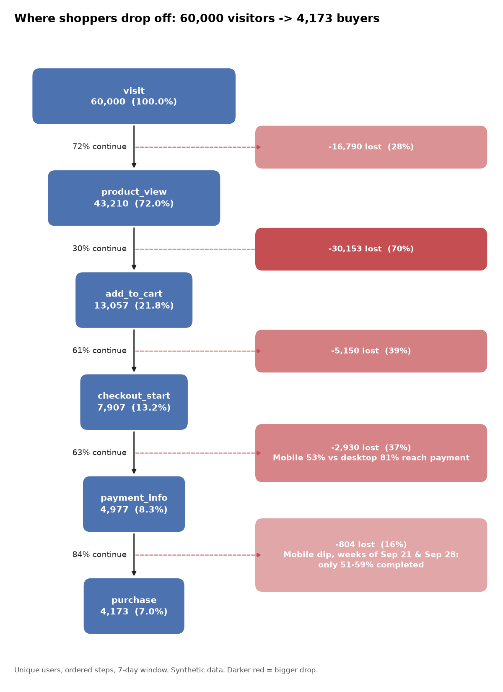

# Checkout Funnel: Summary for Stakeholders
*Shoppers whose first visit was Aug 3 to Oct 25, 2026 (60,000 users). Demo data.*

## Bottom line
**7 in 100 visitors buy.** The biggest fixable leak is **mobile checkout**: 47% of mobile shoppers who start checkout never reach payment, versus 19% on desktop. Closing that gap is worth roughly **+1,100 orders (+27%)** on this period's traffic, assuming later steps convert as they do today.

## What we found
1. **Mobile is 62% of traffic but converts at 5.7%** (desktop: 9.1%). The gap is almost entirely at the step between starting checkout and entering payment details.
2. **Channel quality varies a lot.** Email converts at 11.9% and social at 3.8%. Paid search is a quarter of all traffic but converts at 5.0%, and 39% of its visitors leave before viewing a product.
3. **A payment problem hit mobile in late September.** For two weeks, only 51-59% of mobile shoppers who reached payment completed the order (normally about 86%). That cost roughly 130 orders and went unnoticed until we looked at weekly trends.
4. **Most buyers decide fast.** The median time from first visit to purchase is 33 minutes. A smaller group comes back the next day.

## What we recommend
| Priority | Action | Owner | Why |
|---|---|---|---|
| 1 | Audit mobile checkout: form length, wallet payments, page speed | Product / Engineering | Largest recoverable volume |
| 2 | Alert on payment-to-purchase rate by device | Engineering / Analytics | Catch regressions in days, not weeks |
| 3 | Shift paid-search spend to landing pages and keywords with better product-view rates; improve social product pages | Marketing | Lowest-converting traffic |
| 4 | Test a cart-reminder email within 24 hours | CRM | Captures the next-day return group |

## How we would know it worked
A/B test the redesigned mobile checkout. Success means mobile checkout-to-payment moves from 53% toward desktop's 81% without hurting completion at the last step. Agree the target before launch.

## Caveats
- The data is synthetic, so the numbers demonstrate the method, not a real business.
- Segment gaps show where the problem is, not why. The A/B test is how we confirm the cause.
- The +1,100 estimate assumes downstream conversion stays constant; the true figure could be lower.
